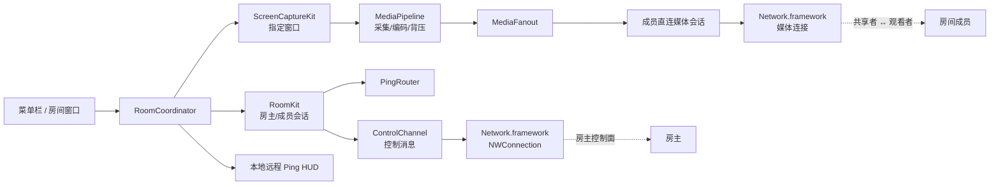

# PartyLOLPing 局域网 MVP Implementation Plan

> **For agentic workers:** REQUIRED SUB-SKILL: Use superpowers:subagent-driven-development (recommended) or superpowers:executing-plans to implement this plan task-by-task. Steps use checkbox (`- [ ]`) syntax for tracking.

**Goal:** 在上游 LoLPing-Mac 的本地 Ping 能力上，增加 macOS 局域网临时房间、指定窗口共享、多人 Ping 路由和远程 HUD，交付可在 2–6 台 Apple Silicon Mac 上验证的 MVP。

**Architecture:** 采用房主控制面 + 成员之间点对点媒体流的拓扑。房主通过 Network.framework/Bonjour 发现并管理成员、邀请码、状态和 Ping；屏幕共享由 ScreenCaptureKit 采集，先用低帧率 JPEG 可靠流验证体验，再以可替换的 VideoToolbox H.264/QUIC 媒体实现优化。所有状态只保存在内存中，房主退出即结束房间。

**Tech Stack:** Swift 5.9、Swift Package Manager、AppKit/SwiftUI、Combine、ScreenCaptureKit、Network.framework、Bonjour、CryptoKit、VideoToolbox、CoreMedia；保留上游 `PingCore` 和现有素材/动画。

**Spec:** [`prd.md`](../../../prd.md)

## Global Constraints

- 目标平台为 macOS 13+、Apple Silicon；MVP 不支持 Intel、Windows、iOS、网页或公网连接。
- 房间限制为 2–6 人；创建者设备是房主，房主退出时房间结束，不做房主迁移。
- 房主可以移除成员；被移除成员的控制连接和媒体票据立即撤销，其他成员继续留在房间。
- 加入方式为当前房间有效的 6 位数字邀请码；邀请码不写入 Bonjour TXT，不作为长期身份或唯一加密密钥。
- 共享范围只允许用户主动选择的单个应用窗口；默认不共享，不支持整个桌面。
- 共享窗口默认对房间内所有成员可见；Ping 选中成员时定向发送，未选中时广播。
- 广播 Ping 的接收目标为除发送者之外的所有在线成员；发送者只显示本地“已发送/失败”状态，避免重复显示自己的远程 HUD。
- 保留上游九种 Ping 和全局轮盘；远程 Ping 默认静音，不保存 Ping 或屏幕历史。
- 接收者可以在本地关闭全部远程 Ping，或按成员静音；这些偏好不回传给发送者，也不改变送达结果。
- 控制面和媒体面都必须有会话级加密；控制消息必须有版本、长度和序列校验。
- 成员、事件和媒体流 ID 在房间内随机生成；`roomEpoch` 变化后旧连接、旧媒体票据和旧事件全部失效。
- 不引入公网服务或大型第三方实时媒体依赖；WebRTC 只作为未来公网模式的候选。
- 媒体采用成员之间直连；任何一端的入站连接被系统防火墙拦截时，只报告“媒体直连失败”，控制面和 Ping 仍可继续工作，不自动把视频绕经房主。
- 任何被拒绝的权限都不能阻止用户使用仍然可用的能力：屏幕录制拒绝仍可入房、观看和发送 Ping；本地网络拒绝时给出设置入口；辅助功能与屏幕录制分开引导。
- 诊断日志不得写入屏幕帧、Ping 历史、邀请码或昵称以外的个人内容。

### Architecture Overview



控制面由房主维护房间事实：成员列表、邀请码校验、状态变更、Ping 路由和媒体票据。媒体面由共享者直接向每个观看者发送，房主只转发媒体协商元数据。位于 `LANTransport` 的 `ControlChannel` 是唯一负责“领域消息 ↔ 加密字节帧”的边界；底层 `TransportConnection` 只处理带长度的原始字节帧，避免重复编码或重复加密。

控制连接的编码顺序固定为：`ControlMessage → MessageEnvelope → canonical JSON → ControlSecureSession.seal → 4 字节大端长度 + 密文`。接收顺序为先检查长度上限，再解密和校验方向/序列，最后解码 JSON；任何一步失败都关闭当前连接。媒体连接使用独立的 `MediaSecureSession`，采用控制面签发的短期媒体票据绑定房间、双方成员、流 ID 和过期时间；JPEG 与后续 H.264 共用同一个 `EncodedFrame/FrameChunk` 包络。

MVP 的安全边界是“防止局域网被动窃听和普通误入”，不是强身份系统。X25519 提供每次连接的前向保密，邀请码证明绑定双方 nonce、`roomID`、`roomEpoch` 和 transcript；6 位邀请码仍可能被主动攻击者猜测，因此必须配合连接预算、失败锁定和房间有效期。MVP 不做证书/账号信任链，公网版本再引入账号或设备密钥。

SwiftPM target 按单向依赖组织：`PartyDomain`（纯 Foundation）→ `PartyProtocol`（CryptoKit）→ `LANTransport`（Network.framework）；`MediaPipeline` 依赖 `PartyDomain`、`PartyProtocol` 和 `LANTransport`；`RoomKit` 依赖上述领域、协议、网络和媒体抽象；`PartyLOLPing` 负责 AppKit/SwiftUI 组装。任何底层 target 都不反向依赖 `PartyLOLPing`，这样可以在没有屏幕录制权限的环境中单独运行纯逻辑和 fake transport 测试。

## Review Focus

- **权限分层**：拒绝屏幕录制、辅助功能、本地网络或防火墙时，用户应能继续使用未受影响的能力；由 Task 8 的权限测试覆盖。
- **不可信控制输入**：超大、未知版本、重复序列或伪造目标的消息必须被拒绝且不崩溃；由 Task 2/3 的协议测试覆盖。
- **加密实现边界**：`ControlSecureSession` 和 `MediaSecureSession` 必须独立通过篡改、重放、乱序、ticket 错绑和随机输入测试，再进入实机验证；不得在 UI 或 RoomKit 中复制密码逻辑。
- **房主断线**：房主关闭、睡眠或网络切换后，成员应进入可理解的重连状态，最终收到房间结束；由 Task 4/5/9 的集成测试覆盖。
- **媒体背压**：慢接收端不能无限积累帧或阻塞 Ping/UI；由 Task 6/7 的帧队列和压力测试覆盖。
- **局域网边界**：访客 Wi‑Fi、AP 隔离、不同 VLAN、Wi‑Fi/以太网切换需要可诊断的失败或重发现结果；由 Task 4/9 的实机矩阵覆盖。

---

### Task 1: 导入上游基线并建立可构建的 PartyLOLPing 包

**Files:**
- Create: `Package.swift`
- Create: `Sources/PingCore/**`、`Sources/PartyLOLPing/**`、`Resources/**`、`scripts/**`、`Tests/PingCoreTests/**`（从上游 commit `0b9d67221f5501b6e5e660ea6d452220df4be5ac` 导入；上游 `Sources` 下的应用目录在重命名 target 时一并迁移）
- Modify: `Sources/PartyLOLPing/AppDelegate.swift`、`Resources/Info.plist`、`README.md`
- Test: `Tests/PingCoreTests/**`

**Interfaces:**
- Consumes: 上游 `PingCore.PingKind`、`GestureMachine`、`OverlayController`、`AppModel`、资源清单和测试。
- Produces: 可执行的 `PartyLOLPing` target、稳定的 `PingCore` target，以及后续任务使用的现有 `AppModel`/`OverlayController` 接口。

- [ ] **Step 1: 固定上游来源和归属信息**

  将上游指定 commit 的源码、素材、声音、`asset-sources.json` 和测试导入当前仓库；保留上游声明，并新增 PartyLOLPing 的项目说明和素材归属说明。

- [ ] **Step 2: 调整 SwiftPM target**

  在 `Package.swift` 中保留 `PingCore`，将可执行产品和 target 命名为 `PartyLOLPing`，平台下限设为 `.macOS(.v13)`；暂不引入第三方依赖。

- [ ] **Step 3: 更新 bundle 元数据**

  将应用显示名、bundle identifier、菜单栏文案和权限说明统一为 PartyLOLPing；保留上游 Ping 资源名称，避免破坏资产加载。明确由 `scripts/build.sh` 把 `Resources/Info.plist` 合并为最终 app bundle 的 `Contents/Info.plist`，而不是把 plist 当作普通资源复制。

- [ ] **Step 4: 运行基线测试**

  Run: `zsh scripts/test.sh`
  Expected: 上游 `PingCore` 测试通过，且构建产物可以启动本地 Ping 预览。

- [ ] **Step 5: Commit**

  ```bash
  git add Package.swift Sources Resources Tests scripts README.md
  git commit -m "build: bootstrap PartyLOLPing from LoLPing-Mac"
  ```

### Task 2: 建立纯逻辑领域模型与房间状态机

**Files:**
- Create: `Sources/PartyDomain/RoomTypes.swift`
- Create: `Sources/PartyDomain/InviteCode.swift`
- Create: `Sources/PartyDomain/RoomReducer.swift`
- Create: `Sources/PartyDomain/PingRouting.swift`
- Create: `Sources/PartyDomain/RemotePingPreferences.swift`
- Create: `Sources/PartyDomain/WindowMetadata.swift`
- Modify: `Package.swift`
- Test: `Tests/PartyDomainTests/InviteCodeTests.swift`
- Test: `Tests/PartyDomainTests/RoomReducerTests.swift`
- Test: `Tests/PartyDomainTests/PingRoutingTests.swift`

**Interfaces:**
- Produces:
  - `public struct RoomID: RawRepresentable, Codable, Hashable, Sendable`
  - `public struct MemberID: RawRepresentable, Codable, Hashable, Sendable`
  - `public struct InviteCode: Codable, Hashable, Sendable`，只接受正好 6 位 ASCII 数字并保留前导零
  - `public enum RoomRole { case host, guest }`
  - `public enum RoomState { case idle, hosting, active, ended, connectionLost }`
  - `public enum ShareState { case none, sharing, paused }`
  - `public enum MemberPresence { case joined, sharing, paused, disconnected, left }`
  - `public struct MemberSnapshot: Codable, Equatable, Sendable`，包含 `memberID`、昵称、角色、在线状态、`shareState` 和可选 `WindowMetadata`；昵称最多 32 个 UTF‑8 字节
  - `public struct RoomSnapshot: Codable, Equatable, Sendable`，包含 `roomID`、`roomEpoch`、`state`、成员快照和仅房主可见的可选 `inviteCode`
  - `public struct WindowMetadata: Codable, Equatable, Sendable`：`windowID`、`ownerBundleID`、`title`、`pixelSize`；标题最多 128 个 UTF‑8 字节且过滤控制字符；类型放在 PartyDomain，供 RoomKit、MediaPipeline 和 UI 共用，避免模块循环依赖
  - `public struct PingRoute: Codable, Equatable, Sendable`，空目标集合表示广播
  - `public struct PingEvent: Codable, Equatable, Sendable`，包含 `eventID`、`senderID`、`kindRawValue`、`route`、用于展示的 `sentAt` 和相对 `ttlMillis`；TTL 从房主接受事件或接收端收到事件时开始计算，不依赖跨设备时钟同步
  - `public struct PingDelivery: Codable, Equatable, Sendable`，包含 `eventID`、`acceptedTargets`、`deliveredTargets` 和失败原因；不包含接收者的静音设置
  - `public enum RoomDomainEvent` 与 `public struct RoomReducer`，用于验证房间和成员状态迁移；RoomKit 的传输事件另命名为 `RoomApplicationEvent`，不与领域事件重名
  - `public struct RemotePingPreferences`，只保存在本机，包含 `enabled`、`remoteAudioEnabled` 和 `mutedMemberIDs`
- Consumes: 无 AppKit、Network、ScreenCaptureKit 或 PingCore 依赖；仅使用 Foundation。

- [ ] **Step 1: 编写邀请和路由失败测试**

  覆盖空字符串、非数字、非 6 位、前导零、已过期房间、重复 Ping ID、离线目标和广播目标；明确广播不包含发送者。窗口标题和昵称按 UTF‑8 字节数限长并拒绝控制字符，防止异常元数据污染 UI 或日志。

- [ ] **Step 2: 编写状态机失败测试**

  覆盖 `idle → hosting → active → ended`、访客加入/离开、共享状态切换、房主结束后拒绝新事件，以及所有非法迁移返回明确错误。

- [ ] **Step 3: 实现模型与 reducer**

  所有模型实现 `Codable`、`Equatable`、`Sendable`；状态机不读写文件、不依赖时间全局变量，时间通过事件字段传入。`RoomID`、`MemberID`、`eventID` 和 `streamID` 使用随机字节生成；成员重连复用 `MemberID`，新房间或 `roomEpoch` 变化时全部失效。

- [ ] **Step 4: 实现 Ping 路由规则**

  定向路由只保留仍在房间且在线的目标；广播路由展开为除发送者之外的当前在线成员；路由器不保存历史，交由上层返回 `accepted`、`delivered` 或 `failed`。本地 `RemotePingPreferences` 只在接收端过滤 HUD/音频，不改变房主的送达回执。

- [ ] **Step 5: 验证**

  Run: `swift test --filter PartyDomainTests`
  Expected: 所有领域模型、邀请码和状态迁移测试通过。

- [ ] **Step 6: Commit**

  ```bash
  git add Package.swift Sources/PartyDomain Tests/PartyDomainTests
  git commit -m "feat: add room domain and state model"
  ```

### Task 3: 定义版本化控制协议、帧编码和会话加密

**Files:**
- Create: `Sources/PartyProtocol/ProtocolVersion.swift`
- Create: `Sources/PartyProtocol/MessageEnvelope.swift`
- Create: `Sources/PartyProtocol/ControlMessage.swift`
- Create: `Sources/PartyProtocol/LengthPrefixedCodec.swift`
- Create: `Sources/PartyProtocol/CanonicalJSONEncoder.swift`
- Create: `Sources/PartyProtocol/ControlSecureSession.swift`
- Create: `Sources/PartyProtocol/MediaSecureSession.swift`
- Create: `Sources/PartyProtocol/MediaTicket.swift`
- Modify: `Package.swift`
- Test: `Tests/PartyProtocolTests/ControlMessageTests.swift`
- Test: `Tests/PartyProtocolTests/FrameCodecTests.swift`
- Test: `Tests/PartyProtocolTests/ControlSecureSessionTests.swift`
- Test: `Tests/PartyProtocolTests/MediaSecureSessionTests.swift`

**Interfaces:**
- Produces:
  - `public enum ProtocolVersion { static let current = 1 }`
  - `public struct MessageEnvelope: Codable, Sendable, Equatable`，字段为 `version`、`messageID`、`roomID`、`senderID`、`sequence`、`sentAt`、`body: ControlMessage`
  - `public enum ControlMessage: Codable, Sendable, Equatable`，至少包含 `hello`、`challenge`、`joinRequest`、`joinAccepted`、`joinRejected`、`rosterSnapshot`、`memberStateChanged`、`memberRemoved`、`pingEvent`、`pingDelivery`、`heartbeat`、`heartbeatAck`、`roomEnded`、`mediaOffer`、`mediaAnswer`、`keyframeRequest`、`mediaStop`；媒体协商消息携带 `MediaTicket` 的结构化字段，不把 token 拼进不透明字符串
  - `public struct LengthPrefixedCodec`：4 字节大端长度 + bytes payload；控制密文帧最大 64 KiB，超限或长度为零立即拒绝
  - `public actor ControlSecureSession`：在原始字节帧之上完成控制握手、序列检查和 AEAD 加解密
  - `public actor MediaSecureSession`：用媒体票据绑定双方和 transcript，完成媒体握手、方向密钥派生、帧序列检查和 AEAD 加解密
- Consumes: `PartyDomain` 的 RoomID/MemberID/Ping 类型。

- [ ] **Step 1: 编写 round-trip 和拒绝测试**

  对每种 `ControlMessage` 做 JSON round-trip；验证未知协议版本、未知消息类型、长度为零、长度超过 64 KiB、截断 payload、重复序列和方向错误均返回协议错误。测试确认 `MessageEnvelope.body` 不是任意未校验的 JSON。

- [ ] **Step 2: 定义握手 transcript**

  使用 `Hello(clientPublicKey, clientNonce, protocolVersions, capabilities)`、`Challenge(hostPublicKey, hostNonce, roomID, roomEpoch)` 和 `JoinRequest(nickname, inviteProof)` 三步握手；邀请码只在握手后的加密会话中提交。由 `CanonicalJSONEncoder` 固定 sorted keys、日期和字节表示，或改用显式长度前缀字段，确保 transcript 在不同进程中得到相同字节。`inviteProof` 是对双方 nonce、`roomID`、`roomEpoch`、公钥和 transcript 的 HMAC，禁止跨房间、跨 epoch 或跨连接重放。

  房主只有在邀请码证明、昵称边界、成员上限和当前 `roomEpoch` 全部通过后才分配 `MemberID` 并写入 roster；失败请求不占用成员名额，也不把原始输入写入日志。

- [ ] **Step 3: 实现会话密钥**

  使用 CryptoKit 的 Curve25519 key agreement 和 HKDF-SHA256 派生方向密钥，再用 ChaChaPoly 加密控制帧；每个方向使用单调递增序列派生 nonce，序列在解密成功后校验并拒绝重放和倒退。媒体会话使用独立的 Curve25519 临时密钥，并把控制面签发的 `MediaTicket` 作为 HKDF 上下文和 transcript proof；媒体帧不会复用控制 nonce。6 位邀请码只作为临时入房证明，不能被文档描述为强身份认证。

- [ ] **Step 4: 实现恒时邀请码校验和限速接口**

  定义 `InviteProofVerifier`，默认每个连接最多 5 次失败，锁定 30 秒；验证逻辑不把邀请码写入日志或 Bonjour TXT。

- [ ] **Step 5: 固定编码与加密边界**

  固定供 Task 4 `ControlChannel` 使用的边界：`TransportConnection` 只收发原始长度帧，控制消息按 `ControlMessage → Envelope → JSON → AEAD` 编解码；接收端先做长度上限检查，再解密、校验序列和方向，最后解码。控制面连接建立前增加每来源并发连接预算和握手速率限制，避免攻击者通过反复 Curve25519 握手消耗资源。

- [ ] **Step 6: 验证**

  Run: `swift test --filter PartyProtocolTests`
  Expected: round-trip、版本拒绝、长度边界、重放、篡改、错误邀请码和媒体票据绑定测试全部通过；对随机截断/乱序字节做 fuzz 或 property-based 测试时不崩溃、不无限分配内存。

- [ ] **Step 7: Commit**

  ```bash
  git add Package.swift Sources/PartyProtocol Tests/PartyProtocolTests
  git commit -m "feat: add versioned control protocol"
  ```

### Task 4: 实现 Bonjour 发现、房主监听和成员控制连接

**Files:**
- Create: `Sources/LANTransport/LANConfiguration.swift`
- Create: `Sources/LANTransport/BonjourAdvertiser.swift`
- Create: `Sources/LANTransport/BonjourBrowser.swift`
- Create: `Sources/LANTransport/HostListener.swift`
- Create: `Sources/LANTransport/TransportConnection.swift`
- Create: `Sources/LANTransport/ControlChannel.swift`
- Create: `Sources/LANTransport/ReconnectPolicy.swift`
- Modify: `Package.swift`
- Test: `Tests/LANTransportTests/TransportFramingTests.swift`
- Test: `Tests/LANTransportTests/ReconnectPolicyTests.swift`
- Test: `Tests/LANTransportTests/FakeTransportTests.swift`

**Interfaces:**
- Produces:
  - `public struct LANConfiguration: Sendable`，包含控制服务 `_partylolping._tcp`、媒体服务 `_partylolping-media._tcp`、心跳间隔 5 秒、超时 15 秒和本地最大成员数 6
  - `public struct DiscoveredRoom: Sendable, Equatable`，只包含非敏感 `serviceID`、协议版本、能力和可连接 endpoint
  - `public actor HostListener`：`start(roomID:)`、`acceptedConnections() -> AsyncStream<TransportConnection>`、`stop()`
  - `public actor BonjourBrowser`：`browse() -> AsyncStream<DiscoveredRoom>`、`stop()`
  - `public actor TransportConnection`：`sendFrame(_ bytes: Data)`、`incomingFrames() -> AsyncThrowingStream<Data, Error>`、`close()`、`state`；只负责 `NWConnection` 生命周期和长度帧，不负责 JSON、邀请码或 AEAD
  - `public actor ControlChannel`：组合 `TransportConnection`、Task 3 的 codec 和 `ControlSecureSession`，对 RoomKit 只暴露 `send(_ envelope:)` 与 `incoming()`；底层不再重复 JSON 或加密
- Consumes: `PartyProtocol` 的 codec/secure session；使用 Network.framework 的 `NWListener`、`NWBrowser` 和 `NWConnection`。

- [ ] **Step 1: 编写 fake transport 测试**

  用内存双端连接验证发送顺序、关闭传播、心跳超时、重连退避、最大帧长度和每来源连接预算，不在单元测试中依赖真实 Wi‑Fi。

- [ ] **Step 2: 实现 Bonjour 广播和浏览**

  房主广播 `_partylolping._tcp`，TXT 仅包含随机 room ID、协议版本和能力，不包含邀请码；成员浏览服务后逐个尝试连接并在加密握手中提交邀请码。媒体服务 `_partylolping-media._tcp` 只在用户开始共享或成为观看端点时发布，TXT 不包含媒体票据。

- [ ] **Step 3: 实现本地监听和连接生命周期**

  使用 `NWListener` 监听临时端口；使用 `NWConnection` 接入 `ControlChannel`，由 `ControlSecureSession` 处理握手和加密；处理 ready、waiting、failed、cancelled 状态，并将状态转换成脱敏的领域事件。媒体 listener 使用独立端口和 `MediaSecureSession`，不复用控制连接的 nonce。

- [ ] **Step 4: 实现心跳和重连**

  每 5 秒发送 heartbeat，15 秒无响应标记断线；重连退避为 0.5、1、2、5、10 秒，达到上限后交给 RoomKit 结束或恢复房间状态。

- [ ] **Step 5: 配置本地网络权限**

  在 `Info.plist` 增加 `NSLocalNetworkUsageDescription` 和 `NSBonjourServices`；如果启用 App Sandbox，补充 `com.apple.security.network.client` 与 `com.apple.security.network.server` entitlement。先以基础 Wi‑Fi/以太网为目标，不启用 peer‑to‑peer Wi‑Fi。

- [ ] **Step 6: 验证服务和打包配置**

  确认 `NSBonjourServices` 同时包含 `_partylolping._tcp` 和 `_partylolping-media._tcp`，并由构建脚本将网络 client/server entitlement 写入最终签名 bundle；测试重复服务实例、端口复用和房主强制退出后的服务撤销。

- [ ] **Step 7: 验证**

  Run: `swift test --filter LANTransportTests`
  Expected: fake transport 测试通过；真实两机手工测试能发现服务、完成握手、发送心跳并正确报告关闭。

- [ ] **Step 8: Commit**

  ```bash
  git add Package.swift Sources/LANTransport Tests/LANTransportTests Resources/Info.plist
  git commit -m "feat: add local network transport"
  ```

### Task 5: 实现房主/成员会话、成员状态和 PingRouter

**Files:**
- Create: `Sources/RoomKit/RoomCoordinator.swift`
- Create: `Sources/RoomKit/HostRoomSession.swift`
- Create: `Sources/RoomKit/GuestRoomSession.swift`
- Create: `Sources/RoomKit/PingRouter.swift`
- Create: `Sources/RoomKit/RoomEvents.swift`
- Modify: `Package.swift`
- Test: `Tests/RoomKitTests/HostRoomSessionTests.swift`
- Test: `Tests/RoomKitTests/GuestRoomSessionTests.swift`
- Test: `Tests/RoomKitTests/PingRouterTests.swift`

**Interfaces:**
- `public actor RoomCoordinator`
  - `createRoom() async throws -> RoomSnapshot`
  - `join(code: InviteCode, nickname: String) async throws -> RoomSnapshot`
  - `sendPing(kindRawValue: String, target: MemberID?) async throws -> PingDelivery`
  - `setShareState(_ state: ShareState, window: WindowMetadata?) async throws`
  - `removeMember(_ memberID: MemberID) async throws`
  - `setRemotePingPreferences(_ preferences: RemotePingPreferences) async`
  - `endRoom() async throws`（仅房主可调用；广播 `roomEnded` 并撤销所有媒体票据）
  - `leave() async`
  - `events() -> AsyncStream<RoomApplicationEvent>`
- `public actor HostRoomSession`：维护内存 roster、房间 epoch、邀请码校验、成员上限和房间结束；`endRoom()` 向成员发送 `roomEnded` 后关闭服务。
- `HostRoomSession.issueMediaTicket(sourceID:viewerID:streamID:)`：只为当前在线成员签发短期票据；移除成员、停止共享或 epoch 变化时立即撤销。
- `public actor GuestRoomSession`：维护本地成员快照、房主连接、重连和房间结束事件。
- `public struct PingRouter`：按 `PingRoute` 展开目标、执行每成员/每房间节流、返回送达结果，不保存历史。
- `public enum RoomApplicationEvent`：封装领域状态变化、传输状态、媒体协商和权限错误；由 `RoomDomainEvent` 映射而来。
- Consumes: `PartyDomain`、`PartyProtocol`、`LANTransport`；UI 只依赖 `RoomCoordinator`，不直接依赖 Network.framework。

- [ ] **Step 1: 编写房主会话测试**

  覆盖创建房间、首位/第六位成员加入、第七位拒绝、错误邀请码限速、昵称 UTF‑8 长度限制、成员离开、房主移除成员、房主结束和新成员在 ended 状态下被拒绝；验证强制退出后房间 epoch 和旧连接均失效。

- [ ] **Step 2: 编写 PingRouter 测试**

  覆盖定向发送、广播（不包含发送者）、离线目标、接收者全局/单成员静音不回传设置、重复 eventID、过期 TTL 和速率限制。

- [ ] **Step 3: 实现房间控制消息处理**

  将 `joinAccepted`、`rosterSnapshot`、`memberStateChanged`、`memberRemoved`、`roomEnded` 映射到 `RoomReducer`；所有成员快照只在内存中维护。房主移除成员只撤销该成员的控制连接和媒体票据，不把对方的本地静音偏好发送出去。

- [ ] **Step 4: 实现 Ping 路由**

  `sendPing` 先在本地确认目标和当前房间状态，再通过房主控制连接发送；房主按在线 roster 转发 `pingEvent` 并返回 `pingDelivery`。初始限流可设为单成员 5 次/10 秒、房间 30 次/10 秒，作为配置项而不是协议常量。接收端收到事件后先应用本地 `RemotePingPreferences`，再决定是否显示 HUD 或播放声音。

- [ ] **Step 5: 验证**

  Run: `swift test --filter RoomKitTests`
  Expected: 使用 fake transport 的 2–6 人房间、成员移除和 Ping 定向/广播测试通过。

- [ ] **Step 6: Commit**

  ```bash
  git add Package.swift Sources/RoomKit Tests/RoomKitTests
  git commit -m "feat: add room sessions and ping routing"
  ```

### Task 6: 实现指定窗口采集和 JPEG 媒体基线

**Files:**
- Create: `Sources/MediaPipeline/CapturePermission.swift`
- Create: `Sources/MediaPipeline/ScreenCaptureSource.swift`
- Create: `Sources/MediaPipeline/VideoFrame.swift`
- Create: `Sources/MediaPipeline/JPEGFrameEncoder.swift`
- Create: `Sources/MediaPipeline/EncodedFrame.swift`
- Create: `Sources/MediaPipeline/FrameChunk.swift`
- Create: `Sources/MediaPipeline/FrameAssembler.swift`
- Modify: `Package.swift`
- Test: `Tests/MediaPipelineTests/EncodedFrameTests.swift`
- Test: `Tests/MediaPipelineTests/FrameAssemblerTests.swift`
- Test: `Tests/MediaPipelineTests/BackpressureTests.swift`

**Interfaces:**
- `public protocol WindowCaptureSource`：`listWindows() async throws -> [WindowMetadata]`、`start(windowID:) -> AsyncThrowingStream<VideoFrame, Error>`、`stop()`。
- `public struct VideoFrame`：`timestamp`、`width`、`height`、`pixelBuffer`；`pixelBuffer` 通过 `PixelBufferBox: @unchecked Sendable` 封装，并只允许在采集/编码串行队列中访问，不跨 Domain/Protocol 层泄漏 ScreenCaptureKit 类型。
  - `public enum MediaCodec { case jpeg, h264 }` 与 `public struct EncodedFrame`：包含 128 位随机 `streamID`、单调 `frameID`、`timestamp`、尺寸、`codec`、`isKeyFrame`、payload；JPEG 和 H.264 共用此包络。
- `public struct FrameChunk`：包含 `frameID`、`chunkIndex`、`chunkCount`、payload 长度和校验值；单 chunk 最大 256 KiB，完整帧最大 1 MiB，超过则分片或丢弃。
- `public protocol FrameEncoder`：`encode(_ frame: VideoFrame) throws -> EncodedFrame`。
- `public actor FrameAssembler`：接收分片、校验长度和校验值、重组完整帧；最多保留 2 个未完成帧/8 MiB，分片 500 ms 超时后清理，并只保留最新未显示帧。
- Consumes: ScreenCaptureKit、CoreMedia、CoreImage；输出可被 MediaSession 使用的抽象帧。

- [ ] **Step 1: 编写帧协议测试**

  覆盖长度前缀、截断、乱序、重复分片、超大 payload、未知 stream ID、codec 标志和完整 JPEG round-trip；为后续 H.264 保留同一包络。

- [ ] **Step 2: 实现窗口枚举和权限状态**

  使用 `SCShareableContent` 列出窗口；使用 `SCContentFilter(desktopIndependentWindow:)` 限定单窗口；单独暴露 `notDetermined`、`denied`、`authorized` 状态，并在最终 bundle 的 `Info.plist` 写入清晰的 `NSScreenCaptureUsageDescription`。

- [ ] **Step 3: 实现采集生命周期**

  使用 `SCStream` 输出帧；窗口关闭、最小化、采集错误和权限变化分别转换为可观察事件；停止必须立即取消 stream 和所有待处理帧。

- [ ] **Step 4: 实现 JPEG 基线编码**

  初始目标为最长边 1280 像素、10 fps、可配置 JPEG 质量；使用单生产者队列，慢接收端只保留最新帧，不阻塞控制面。

- [ ] **Step 5: 验证**

  Run: `swift test --filter MediaPipelineTests`
  Expected: 纯帧处理测试通过；实机 smoke test 能选择窗口、停止窗口、处理外接屏和拒绝屏幕录制权限。共享端只执行一次编码，编码结果可被多个 fan-out 队列读取。

- [ ] **Step 6: Commit**

  ```bash
  git add Package.swift Sources/MediaPipeline Tests/MediaPipelineTests
  git commit -m "feat: add window capture and jpeg pipeline"
  ```

### Task 7: 实现成员之间的直接媒体会话和 fan-out

**Files:**
- Create: `Sources/MediaPipeline/MediaEndpoint.swift`
- Create: `Sources/MediaPipeline/MediaListener.swift`
- Create: `Sources/MediaPipeline/MediaSession.swift`
- Create: `Sources/MediaPipeline/MediaFanout.swift`
- Modify: `Sources/RoomKit/RoomCoordinator.swift`
- Modify: `Sources/PartyProtocol/ControlMessage.swift`
- Test: `Tests/MediaPipelineTests/MediaSessionTests.swift`
- Test: `Tests/RoomKitTests/MediaNegotiationTests.swift`

**Interfaces:**
  - `public struct MediaTicket: Codable, Equatable, Sendable`：`ticketID`、`roomID`、`roomEpoch`、`sourceID`、`viewerID`、`streamID`、随机 token、签发时间和相对有效时长；只通过各自的加密控制连接发送，验证时允许小幅时钟偏差并以本地连接建立时间为准。
- `public struct MediaEndpoint: Codable, Equatable, Sendable`：成员 ID、服务实例、能力、`streamID`、绑定的 `MediaTicket` 和过期时间；不包含长期 IP 或邀请码。
- `public actor MediaListener`：为每个成员提供局域网媒体监听服务并发布非敏感服务实例；握手后必须校验 ticket 的双方成员、房间 epoch、stream ID、过期时间和 transcript proof。
- `public actor MediaSession`：`connect(to:)`、`send(_ frame: EncodedFrame)`、`incomingFrames() -> AsyncThrowingStream<EncodedFrame, Error>`、`requestKeyframe()`、`stop()`；所有帧先分片再交给 `MediaSecureSession` 加密。
- `public actor MediaFanout`：一个共享源为 1–5 个观看者各维护一个加密媒体连接；对慢端丢弃旧帧，不影响其他端。
- Consumes: Task 4 的 LAN transport、Task 6 的 FrameEncoder/Assembler、Task 5 的媒体协商控制消息。

- [ ] **Step 1: 编写一对一媒体会话测试**

  使用 fake listener 验证 offer/answer、媒体 token 过期或错绑、未加密帧拒绝、连接关闭、帧序列和背压；断言 1→5 fan-out 只调用一次 `FrameEncoder`。

- [ ] **Step 2: 实现媒体服务发现和协商**

  每个成员为媒体监听器发布 `_partylolping-media._tcp`；房主只在控制面转发带 `MediaTicket` 的 `MediaOffer/MediaAnswer` 元数据，媒体帧不经过房主。媒体握手使用临时 X25519 密钥和 ticket 绑定的 transcript，HKDF 派生方向密钥，ChaChaPoly 加密每个 `FrameChunk`；每个方向的帧序列和 nonce 独立。

- [ ] **Step 3: 实现共享端 fan-out**

  共享者为每个在线观看者建立一个加密连接；使用同一 `EncodedFrame` 的只读副本，禁止每个观看者重复采集和编码。每个观看者有独立的有界队列，满载时丢弃旧帧并记录计数，不阻塞控制面。

- [ ] **Step 4: 实现观看端重组和状态**

  观看端只显示最新完整帧；连接中、首帧等待、卡顿、停止共享和窗口关闭都必须生成 Room/UI 事件。无法建立媒体直连时显示可理解的媒体错误，控制连接和 Ping 仍保持可用。

- [ ] **Step 5: 验证**

  Run: `swift test --filter MediaSessionTests`
  Expected: fake 1→1、1→3、1→5 fan-out、ticket 绑定和加密拒绝测试通过；实机 1→1 和 1→3 在局域网内能显示画面且 Ping 不被阻塞。

- [ ] **Step 6: Commit**

  ```bash
  git add Sources/MediaPipeline Sources/RoomKit Sources/PartyProtocol Tests
  git commit -m "feat: add direct lan media sessions"
  ```

### Task 8: 接入房间 UI、远程 HUD 和分层权限引导

**Files:**
- Create: `Sources/PartyLOLPing/RoomView.swift`
- Create: `Sources/PartyLOLPing/RoomViewModel.swift`
- Create: `Sources/PartyLOLPing/MemberCardView.swift`
- Create: `Sources/PartyLOLPing/RoomSetupView.swift`
- Create: `Sources/PartyLOLPing/PermissionStatus.swift`
- Modify: `Sources/PartyLOLPing/AppModel.swift`
- Modify: `Sources/PartyLOLPing/AppDelegate.swift`
- Modify: `Sources/PartyLOLPing/ControlView.swift`
- Modify: `Sources/PartyLOLPing/Overlay.swift`
- Modify: `Resources/Info.plist`
- Create: `Resources/PartyLOLPing.entitlements`
- Test: `Tests/PartyLOLPingTests/RoomViewModelTests.swift`

**Interfaces:**
- `public final class RoomViewModel: ObservableObject`：发布 `roomState`、`inviteCode`、`members`、`selectedTarget`、`shareState`、`connectionMessage`、`remotePingEnabled`、`remoteAudioEnabled` 和 `mutedMemberIDs`；房主额外提供 `canRemoveMember` 与 `removeMember(_:)`。
- `public enum PermissionStatus`：分别表示 Accessibility、Local Network 和 Screen Recording；防火墙没有可直接查询的授权 API，单独以 `NetworkDiagnostic` 根据 listener/connection 的 waiting、failed 和超时错误推断并给出排查提示。
- `OverlayController.showRemotePing(kind:sender:)`：在接收者本机安全位置显示 HUD，不使用发送者鼠标坐标。
- `AppModel` 保留本地轮盘逻辑；commit 时调用 `RoomCoordinator.sendPing`，无房间时保持原有本地预览行为。远程 Ping 先在本机按 `RemotePingPreferences` 过滤，再调用 `OverlayController.showRemotePing`。
- Consumes: RoomCoordinator、MediaSession、上游 `PingKind`/`OverlayController`。

- [ ] **Step 1: 编写 RoomViewModel 测试**

  覆盖创建/加入表单、错误码提示、成员状态更新、目标选择清除、房间结束、默认远程静音、单成员静音、全局远程 Ping 开关和房主移除成员。

- [ ] **Step 2: 实现创建/加入界面**

  在现有 AppKit 菜单栏/控制窗口边界内增加 SwiftUI 房间入口；创建后展示邀请码和成员数，加入后展示昵称表单和连接状态。保留上游菜单栏和轮盘的 AppKit 生命周期，不把全局快捷键迁移到房间视图。

- [ ] **Step 3: 实现成员卡片和共享控制**

  成员卡片显示昵称、在线/共享/暂停状态和预览；点击卡片设置 Ping 目标，双击或展开操作查看大图；共享按钮只打开指定窗口选择器，不提供整个桌面选项。成员菜单提供本地静音；房主菜单提供移除成员。

- [ ] **Step 4: 接入远程 HUD**

  复用上游 `PingEffectView` 和资源，但远程事件使用固定安全位置、发送者昵称和本地 `remoteAudioEnabled` 开关；默认不播放远程声音。

- [ ] **Step 5: 分层权限引导**

  `Accessibility` 只解释全局 Ping，`Screen Recording` 只解释窗口共享，`Local Network` 只解释房间连接，`Firewall` 只解释媒体直连；拒绝某一项时仍显示其他可用操作。构建脚本将 `Info.plist` 和 entitlements 写入最终 app bundle，且在签名前检查必需键值。

- [ ] **Step 6: 验证**

  Run: `swift test --filter PartyLOLPingTests`
  Expected: ViewModel 状态测试通过；手工操作可创建/加入房间、选择目标、显示远程 HUD、按成员/全局静音、房主移除成员、暂停/停止共享。拒绝辅助功能时，房间和本地预览仍可用，但全局快捷键明确显示不可用。

- [ ] **Step 7: Commit**

  ```bash
  git add Sources/PartyLOLPing Resources/Info.plist Resources/PartyLOLPing.entitlements Tests/PartyLOLPingTests
  git commit -m "feat: add room ui and remote ping hud"
  ```

### Task 9: 集成验证、诊断和发布打包

**Files:**
- Modify: `scripts/build.sh`
- Modify: `scripts/test.sh`
- Create: `scripts/integration-check.sh`
- Create: `Verification/LAN-MATRIX.md`
- Modify: `Resources/Info.plist`
- Modify: `Resources/PartyLOLPing.entitlements`
- Test: `Tests/IntegrationTests/**`（仅保留可自动化的 fake transport 测试；真实网络列入手工矩阵）

**Interfaces:**
- `scripts/integration-check.sh` 接受 `--host`、`--guest`、`--media` 参数，输出脱敏连接状态和延迟摘要，不保存屏幕帧。
- `Verification/LAN-MATRIX.md` 固定 OS、芯片、网络、权限和预期结果字段。

- [ ] **Step 1: 更新构建和测试脚本**

  保证 `zsh scripts/build.sh`、`zsh scripts/test.sh` 能构建所有 SwiftPM targets，并在没有屏幕录制授权的机器上仍通过纯逻辑测试。

- [ ] **Step 2: 增加脱敏诊断**

  记录协议版本、连接状态、首帧时间、Ping 延迟、帧丢弃计数和重连次数；禁止记录邀请码、屏幕内容和完整昵称历史。

- [ ] **Step 3: 执行两机/三机验收**

  覆盖同 Wi‑Fi、Wi‑Fi↔以太网、外接屏、窗口关闭/最小化、屏幕录制拒绝、本地网络拒绝、辅助功能拒绝、防火墙拒绝、房主退出/崩溃和睡眠唤醒。

- [ ] **Step 4: 执行隔离网络验收**

  覆盖访客 Wi‑Fi/AP 隔离、不同 VLAN/子网、网络切换和 Bonjour 服务冲突；每种失败都要给出可理解的错误状态。

- [ ] **Step 5: 性能和稳定性门槛**

  在 1→5 fan-out 下运行 30–60 分钟；验收首帧目标小于 5 秒、Ping P95 小于 1 秒、无持续内存增长、共享不阻塞轮盘和房间 UI。

- [ ] **Step 6: 签名和权限检查**

  检查最终 app bundle 中的 bundle identifier、entitlements、`NSLocalNetworkUsageDescription`、同时包含两个服务类型的 `NSBonjourServices`、`NSScreenCaptureUsageDescription`、辅助功能提示和防火墙行为；确认媒体帧必须经过 AEAD，记录当前版本只支持 Apple Silicon。

- [ ] **Step 7: Commit**

  ```bash
  git add scripts Verification Resources Tests
  git commit -m "test: verify lan mvp and packaging"
  ```

### Task 10: VideoToolbox H.264/QUIC 性能试验（MVP 后的决策门）

**Files:**
- Create: `Sources/MediaPipeline/H264Encoder.swift`
- Create: `Sources/MediaPipeline/H264Decoder.swift`
- Create: `Sources/MediaPipeline/QUICMediaTransport.swift`
- Create: `Tests/MediaPipelineTests/H264PipelineTests.swift`
- Create: `Verification/MEDIA-DECISION.md`

**Interfaces:**
- `public struct H264Encoder: FrameEncoder`：输出带关键帧标志的编码帧。
- `public struct H264Decoder`：接收完整 NAL 单元并输出可显示帧。
  - `public actor QUICMediaTransport`：使用 Network.framework QUIC stream/datagram；可靠 control stream 承载 `requestKeyframe`、`mediaStop` 和重连状态，不可靠 datagram 承载受路径 MTU 限制的小型 `FrameChunk`（目标 payload 不超过 1200 字节）；两条通道共用 `MediaSecureSession` 的身份绑定但使用独立序列空间。
- Consumes: Task 6 的 `VideoFrame`/`FrameEncoder` 抽象和 Task 7 的 `MediaSession`。

- [ ] **Step 1: 编写编码/解码 round-trip 测试**

  验证关键帧、统一 `EncodedFrame` 包络、MTU 分片、乱序、丢包后的请求和解码失败恢复；测试不依赖实际 ScreenCaptureKit。

- [ ] **Step 2: 实现低延迟编码参数**

  使用 VideoToolbox 的硬件加速和低延迟会议配置；限制分辨率/帧率并记录 CPU、带宽和首帧时间。

- [ ] **Step 3: 与 JPEG 基线对比**

  在同一台 2–6 人局域网环境中比较首帧、P95 延迟、带宽、CPU、断线恢复和画面可读性。

- [ ] **Step 4: 写入决策记录**

  若 H.264/QUIC 在稳定性和实现成本上优于 JPEG，则替换默认媒体实现；否则保留 JPEG 作为 MVP 默认路径，H.264 继续作为后续优化，不阻塞产品发布。无论选择哪条路径，都必须保留 `MediaSecureSession` 和 ticket 绑定，不因换 codec 而降级加密。

- [ ] **Step 5: Commit**

  ```bash
  git add Sources/MediaPipeline Tests/MediaPipelineTests Verification/MEDIA-DECISION.md
  git commit -m "perf: evaluate h264 quic media path"
  ```

## Spec Coverage Map

| PRD 要求 | 计划任务 |
| --- | --- |
| macOS 13+ / Apple Silicon | Task 1、Task 9 |
| 6 位邀请码、临时房间 | Task 2、Task 3、Task 5 |
| 房主控制面、房主退出结束 | Task 4、Task 5 |
| 指定窗口共享 | Task 6、Task 8 |
| 房间内广播观看 | Task 7、Task 8 |
| 九种 Ping、定向/广播 | Task 2、Task 5、Task 8 |
| 远程 HUD、默认静音 | Task 8 |
| 房主移除成员、成员本地静音 | Task 2、Task 5、Task 8 |
| 权限和隐私分层 | Task 4、Task 6、Task 8、Task 9 |
| 断线、网络隔离和异常状态 | Task 4、Task 5、Task 7、Task 9 |
| JPEG 基线与 H.264 决策门 | Task 6、Task 7、Task 10 |

## Technical References

- [LoLPing-Mac 上游仓库](https://github.com/AllenTHT/LoLPing-Mac)：固定导入 commit `0b9d67221f5501b6e5e660ea6d452220df4be5ac`，保留九种 Ping、轮盘和本地覆盖层。
- [Apple ScreenCaptureKit](https://developer.apple.com/documentation/screencapturekit)：窗口枚举、`SCContentFilter` 和 `SCStream`。
- [Apple Network framework / NWListener](https://developer.apple.com/documentation/network/nwlistener)：本地监听、连接状态和 Bonjour 服务。
- [Apple Bonjour](https://developer.apple.com/documentation/network/bonjour)：局域网服务发布与发现。
- [Apple：从 Multipeer Connectivity 迁移到 Network framework](https://developer.apple.com/documentation/technotes/tn3213-moving-from-multipeer-connectivity-to-network-framework)：不把已弃用的 Multipeer Connectivity 作为新架构核心。
- [Apple：理解本地网络隐私](https://developer.apple.com/documentation/technotes/tn3179-understanding-local-network-privacy)：`NSLocalNetworkUsageDescription`、Bonjour 和权限失败处理。
- [Apple VideoToolbox](https://developer.apple.com/documentation/videotoolbox)：Task 10 的硬件 H.264 评估。
- [WebRTC TURN server guidance](https://webrtc.org/getting-started/turn-server)：只作为未来跨公网模式的中继参考，不进入本地 MVP 依赖。

## Implementation Order and Definition of Done

按 Task 1 → 9 顺序实施；Task 10 在 JPEG 基线和实机矩阵完成后再执行。每个 Task 完成时必须满足：

1. 对应的纯逻辑或 fake transport 测试通过。
2. 新增协议和状态均有明确错误路径。
3. 停止共享、离开房间和取消操作立即生效。
4. 诊断日志脱敏且不落盘屏幕/Ping 历史。
5. 文档中的接口名称与实现保持一致，并单独提交一个可回滚 commit。
