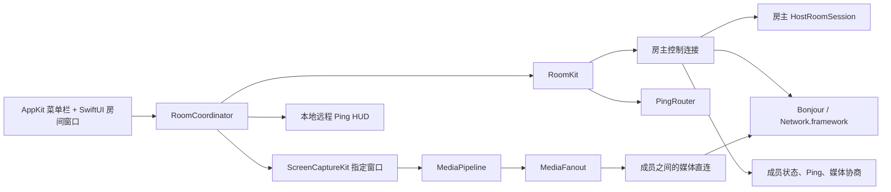
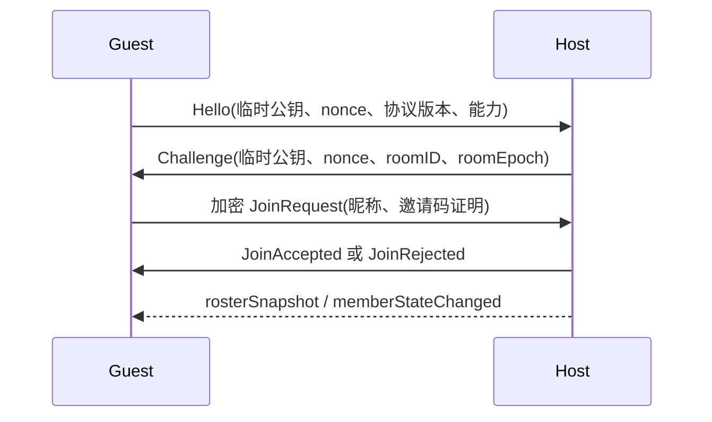

# PartyLOLPing 局域网 MVP 技术方案

**版本**：v0.1
**日期**：2026-10-12
**依据**：[产品需求文档](prd.md)
**详细实施清单**：[局域网 MVP Implementation Plan](docs/superpowers/plans/2026-10-12-party-lol-ping-lan-mvp.md)

## 1. 方案结论

PartyLOLPing 继续使用上游 LoLPing-Mac 的 Swift/AppKit 原生应用和 PingCore，把多人能力拆成两个网络平面：房主负责房间控制和 Ping 路由，屏幕画面由共享者直接发送给观看者。这样房主只承担控制消息和成员状态，不转发所有视频帧，2–6 人局域网房间的带宽和故障范围更容易控制。

上游基线固定为 `AllenTHT/LoLPing-Mac` 的 commit `0b9d67221f5501b6e5e660ea6d452220df4be5ac`，保留现有九种 Ping、轮盘、全局快捷键、覆盖层动画和素材归属说明。

MVP 先用 ScreenCaptureKit 采集指定应用窗口，以低帧率 JPEG 可靠流验证体验；帧协议从一开始就使用通用的 `EncodedFrame/FrameChunk`，后续可以接入 VideoToolbox H.264 和 QUIC，而不改变房间、UI 或 Ping 逻辑。MVP 不需要公网服务器、账号、录制、语音或远程控制。

## 2. 固定范围

| 项目 | 技术决定 |
| --- | --- |
| 平台 | macOS 13+、Apple Silicon |
| 网络 | 同一可互通局域网，基础 Wi‑Fi 和以太网 |
| 房间 | 临时房间，2–6 人，创建者是房主 |
| 加入 | Bonjour 发现服务，连接后输入 6 位数字邀请码 |
| 共享 | 用户主动选择的单个应用窗口，默认对全房间可见 |
| Ping | 保留上游九种信号；选中成员定向，否则广播给其他在线成员 |
| 远程声音 | 默认静音；接收者可全局或按成员静音 |
| 存储 | 房间、屏幕帧、Ping 事件和邀请码只在内存中存在 |
| 房主异常 | 房主退出或失联后房间结束，不做房主迁移 |

## 3. 运行时架构



房主创建临时控制服务 `_partylolping._tcp`。成员通过 Bonjour 找到候选服务后，建立控制连接并在加密会话中提交邀请码。媒体服务 `_partylolping-media._tcp` 只用于直连媒体端点发现；邀请码和媒体票据都不放入 Bonjour TXT。

SwiftPM target 按单向依赖组织：

```text
PartyDomain (Foundation)
    ├── PartyProtocol (CryptoKit)
    │      └── LANTransport (Network.framework + Bonjour)
    └── MediaPipeline (ScreenCaptureKit + CoreMedia + VideoToolbox)
             └── RoomKit (房间编排、Ping、媒体协商)
                      └── PartyLOLPing (AppKit/SwiftUI 组装)
```

底层模块不依赖应用 target。没有屏幕录制权限时，`PartyDomain`、`PartyProtocol`、`LANTransport` 的纯逻辑和 fake transport 测试仍然可以运行。

## 4. 控制面设计

### 4.1 连接与编码

`TransportConnection` 只负责 Network.framework 连接生命周期和带长度的原始字节帧；位于 `LANTransport` 的 `ControlChannel` 是唯一的控制消息边界。编码顺序固定为：

```text
ControlMessage
  → MessageEnvelope(version, messageID, roomID, senderID, sequence, sentAt)
  → canonical JSON
  → ControlSecureSession.seal
  → 4 字节大端长度 + 密文
```

接收端先检查长度（控制密文最大 64 KiB，长度为零立即拒绝），再解密、校验方向和单调序列，最后解码 JSON。握手 transcript 使用固定 sorted keys、日期和字节表示，避免不同进程生成不同的证明摘要。未知版本、未知消息类型、截断、重放、篡改和超大消息都会关闭当前连接，不影响应用进程。

### 4.2 加入握手



双方使用 CryptoKit 的 Curve25519 临时密钥和 HKDF-SHA256 派生方向密钥，再用 ChaChaPoly 保护控制帧。邀请码证明绑定双方 nonce、公钥、`roomID`、`roomEpoch` 和握手 transcript；每个连接最多 5 次失败，失败后锁定 30 秒，并限制来源并发握手数。6 位邀请码是临时入房门槛，不是长期身份或强认证凭据。

### 4.3 房间事实和 Ping

房主内存中维护 roster、房间 epoch、成员角色、共享状态和邀请码有效期。房主可以结束房间或移除成员；结束房间会广播 `roomEnded` 并撤销全部媒体票据，移除成员只撤销该成员的控制连接和媒体票据。广播 Ping 的目标是除发送者之外的在线成员，接收端再按本地静音偏好决定是否显示 HUD 或播放声音，静音设置不会回传给发送者。Ping 的 TTL 用相对时长计算，不要求设备时钟同步。初始限流建议为单成员 5 次/10 秒、房间 30 次/10 秒，并保留为可调配置。

成员和事件 ID 使用随机值。成员重连可以复用 `MemberID`，但房间结束或 `roomEpoch` 变化后，旧连接、旧事件和旧媒体票据全部失效。

## 5. 媒体面设计

### 5.1 窗口采集

使用 `SCShareableContent` 枚举窗口，用户选择后用 `SCContentFilter(desktopIndependentWindow:)` 创建 `SCStream`。采集模块只输出项目自己的 `VideoFrame`，不把 ScreenCaptureKit 类型泄漏到领域层。`CVPixelBuffer` 用明确的串行队列封装，避免跨 actor 无保护访问。

默认参数从最长边 1280 像素、10 fps、可配置 JPEG 质量开始。生产队列和每个观看端队列都有上限；慢端只保留最新帧，不能阻塞 Ping、房间控制或菜单栏 UI。

### 5.2 帧包络和直连

```text
EncodedFrame(codec, streamID, frameID, timestamp, width, height, isKeyFrame, payload)
  → FrameChunk(frameID, chunkIndex, chunkCount, length, checksum)
  → MediaSecureSession 加密
  → 成员之间的 Network.framework 连接
```

单 chunk 上限 256 KiB，完整帧上限 1 MiB；重组最多保留 2 个未完成帧或 8 MiB，分片 500 ms 超时清理。共享者只编码一次，然后把同一 `EncodedFrame` 的只读副本放入 1–5 个观看端队列。

### 5.3 媒体认证和加密

房主通过各自的加密控制连接签发 `MediaTicket`，票据绑定 `roomID`、`roomEpoch`、共享者、观看者、`streamID`、随机 token 和相对有效时长。共享者与观看者建立媒体直连时，用临时 X25519 密钥和 ticket transcript 完成 `MediaSecureSession` 握手，再用独立方向密钥和序列保护每个 `FrameChunk`。未加密、错绑、过期或倒退序列的媒体帧必须被拒绝；验证以连接建立时间为准，容忍小幅设备时钟偏差。

房主只转发 `MediaOffer/MediaAnswer` 元数据和票据，不转发帧。若系统防火墙或 AP 隔离阻断媒体直连，UI 显示媒体连接失败，控制面和 Ping 仍保持可用。

### 5.4 H.264/QUIC 决策门

JPEG 路径完成实机矩阵后，再评估 VideoToolbox H.264。若采用 QUIC，可靠 control stream 承载关键帧请求、停止和重连状态，不可靠 datagram 使用不超过路径 MTU 的小分片（目标 payload 不超过 1200 字节）；两条通道共用身份绑定但使用不同序列空间。只有在首帧、延迟、带宽、CPU、断线恢复和 1→5 fan-out 稳定性都优于 JPEG 时才替换默认实现。

## 6. 权限、隐私和安全边界

- `NSScreenCaptureUsageDescription` 只解释指定窗口共享；拒绝后仍可入房、观看和发 Ping。
- `NSLocalNetworkUsageDescription` 和 `NSBonjourServices` 只解释房间发现和连接；拒绝时提供系统设置入口。
- 辅助功能权限只用于上游全局快捷键；拒绝后保留房间和窗口内预览，并明确提示快捷键不可用。
- macOS 没有可直接查询的防火墙授权状态；根据 listener/connection 的 waiting、failed 和超时错误给出推断性排查提示，不伪装成系统权限值。
- App Sandbox 使用 `com.apple.security.network.client` 和 `com.apple.security.network.server`；构建脚本在最终签名 bundle 中检查 plist 和 entitlements。
- 不采集麦克风、键盘或整个桌面；不保存屏幕帧、Ping 历史、邀请码或聊天记录。
- 诊断只记录协议版本、连接状态、首帧时间、Ping 延迟、丢帧数和重连次数，不记录屏幕内容和邀请码。

MVP 的安全目标是保护局域网中的被动窃听并阻止普通误入。由于没有账号或设备信任链，6 位邀请码不能抵抗有意的主动猜测或冒充；因此采用连接限速、失败锁定、ticket 过期和 epoch 失效。跨公网版本再引入账号、设备密钥、WebRTC 和 TURN。

## 7. 验证和发布门槛

1. **纯逻辑测试**：邀请码、房间 reducer、Ping 路由、协议 round-trip、长度边界、AEAD 篡改、媒体 ticket 绑定、帧重组和背压。
2. **fake transport 测试**：2–6 人加入/离开、房主移除成员、重连退避、心跳超时、广播/定向 Ping、1→5 fan-out。
3. **两机/三机实机测试**：同一 Wi‑Fi、Wi‑Fi↔以太网、外接屏、窗口关闭/最小化、睡眠唤醒、房主强退、辅助功能/本地网络/屏幕录制/防火墙拒绝。
4. **网络边界测试**：访客 Wi‑Fi、AP 隔离、不同 VLAN/子网、Bonjour 冲突和网络切换；每种失败给出可理解的状态。
5. **性能门槛**：首帧小于 5 秒，Ping P95 小于 1 秒，1→5 fan-out 持续 30–60 分钟无持续内存增长，共享不阻塞轮盘和房间 UI。
6. **发布检查**：Apple Silicon、macOS 13+、bundle identifier、签名、Info.plist、entitlements、资源归属和上游许可证说明。

## 8. 主要风险和处理

| 风险 | 处理 |
| --- | --- |
| 客户端入站连接被防火墙阻断 | 控制面和媒体面分开报告；媒体失败不阻塞 Ping；验收矩阵覆盖 |
| JPEG 在 1→5 时带宽过高 | 有界队列和低帧率起步；用 H.264/QUIC 决策门验证，不提前绑定 UI |
| 自定义会话加密实现错误 | 将 `ControlSecureSession`/`MediaSecureSession` 隔离成小模块，做篡改、重放、乱序和 fuzz 测试，并在合并前单独安全审查 |
| ScreenCaptureKit 对受保护窗口或最小化窗口输出黑帧 | 明确显示不可采集/等待恢复状态，不伪造正常画面 |
| 上游图标和音效授权不清晰 | 保留 `asset-sources.json` 和上游声明，公开发布前重新审查素材及商标说明 |
| 未来扩展公网需要服务端 | 目前不引入；V2 单独设计信令、TURN/SFU、账号和设备身份 |

实施顺序和每个任务的文件、接口、测试、提交边界见[详细实施清单](docs/superpowers/plans/2026-10-12-party-lol-ping-lan-mvp.md)。

参考：[Apple ScreenCaptureKit](https://developer.apple.com/documentation/screencapturekit)、[Apple Network framework](https://developer.apple.com/documentation/network)、[Apple 本地网络隐私](https://developer.apple.com/documentation/technotes/tn3179-understanding-local-network-privacy)、[Apple VideoToolbox](https://developer.apple.com/documentation/videotoolbox)。
